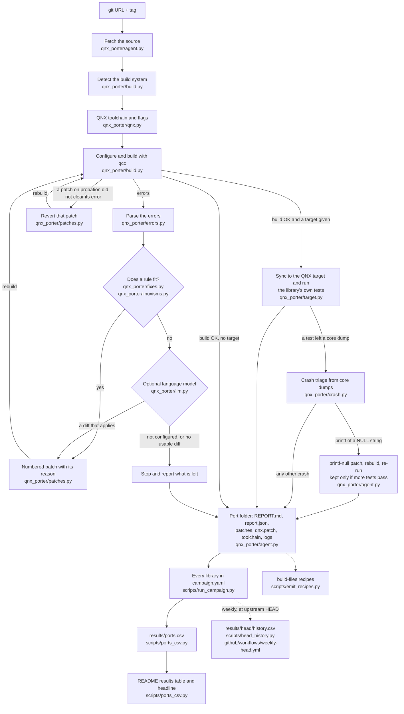

# How qnx-porter works

The pipeline as the code runs it, for one library (`qnx-porter port`, or one entry of `campaign.yaml`), and
then for the whole campaign. Each box names the file that does the work; the paragraphs below the diagram take
the boxes in order.

## The boxes

**git URL + tag.** The input: `qnx-porter port <url> --tag <tag>` (`qnx_porter/cli.py`), or one library from
`campaign.yaml` with its tag, extra configure arguments and an optional note.

**Fetch the source** (`qnx_porter/agent.py`, `port()`). A shallow clone at the tag, with submodules, tagged
`qnx-porter-base` so that every later change is a git diff against upstream. A second run resets to that tag
instead of cloning again.

**Detect the build system** (`qnx_porter/build.py`, `detect()`). CMake, then Meson, then autotools, then plain
Make, by the files in the source folder (or the `subdir` that `campaign.yaml` names).

**QNX toolchain and flags** (`qnx_porter/qnx.py`). Finds the SDP (`sdp_env()` reads `QNX_HOST` and
`QNX_TARGET`, sourcing `~/qnx800/qnxsdp-env.sh` if needed) and writes what each build system needs:
`cmake_toolchain()` (`CMAKE_SYSTEM_NAME QNX`, `qcc` with `CMAKE_C_COMPILER_TARGET gcc_ntox86_64` or
`gcc_ntoaarch64le`, `CMAKE_SYSROOT $QNX_TARGET`), `meson_cross()` and `gnu_env()` for autotools and Make
(`--host=x86_64-pc-nto-qnx8.0.0` or `aarch64-unknown-nto-qnx8.0.0`). `Flags` holds every flag a rule adds;
`write_wrappers()` puts flags that must come after the project's own into small compiler wrappers. Empty
`libpthread.a`, `librt.a` and `libdl.a` stand in for libraries whose functions QNX keeps in libc.

**Configure and build with qcc** (`qnx_porter/build.py`, `Job.steps()` and `run()`). The configure and build
commands for the detected system, with tests turned on. Each round's output goes to `logs/round-NN.log`. When a
flag fix changes the CMake toolchain, `agent.py` deletes the CMake cache first, because CMake reads the initial
flags only into a fresh cache.

**Parse the errors** (`qnx_porter/errors.py`, `parse()`). Turns GCC, GNU ld, CMake, configure and Meson output
into `Diagnostic` records: implicit declaration, undeclared symbol, missing header, `-Werror` warning,
undefined reference, missing `-l` library, multiple definition, CMake or configure error.

**Does a rule fit?** (`qnx_porter/fixes.py`, `plan()` and `_rule()`; `qnx_porter/linuxisms.py`). Deterministic
rules, each acting only on what the compiler or linker printed plus documented facts about QNX 8.0: the POSIX
header for a symbol, `-lsocket`, `-lm`, `_QNX_SOURCE`, `-Wno-error=<warning>`, guards around Linux-only headers,
`prctl(PR_SET_NAME)` to `pthread_setname_np()`, and the rest listed with their sources in
[LINUX_ISMS.md](LINUX_ISMS.md). At most one fix per file and per flag in a round, and never the same fix twice.
A rule that needs proof (for example adding QNX to an OS `#if` chain) is applied alone and put on probation.

**Optional language model** (`qnx_porter/llm.py`). Only when no rule fits, and only if
`QNX_PORTER_API_KEY`, `QNX_PORTER_MODEL` and `QNX_PORTER_BASE_URL` are set. The model gets the error, the
code around it, the end of the build log and a QNX hint from `fixes.hint()`, and must answer with a diff and a
one-sentence reason. `agent.py` tries it at most twice per error. Its diff is always on probation: it is
reverted unless the rebuild clears the error. `--no-model` turns the step off; the published results used rules
only.

**Numbered patch with its reason** (`qnx_porter/patches.py`). Every change becomes a numbered file in `patches/`
(`0001-link-libsocket.patch`, say) with a header naming the rule, whether a rule or the model wrote it, the reason, and the exact error it
answers. Source changes are git commits in the checkout (`commit_source()`); flag changes are diffs of the
generated toolchain file (`record_flags()`). `export_series()` writes all kept source changes as `qnx.patch`.

**Revert that patch** (`qnx_porter/agent.py` decides, `patches.py` `revert_last()` acts). After the rebuild,
a patch on probation is reverted if its error is still there or new errors appeared in the files it touched.
New errors elsewhere count as progress (a compile fix lets the linker run). The report lists it as `reverted`.

**Stop and report what is left.** When neither a rule nor the model has a fix, the loop stops, and the first
errors go into the report's "Still failing" section with a QNX hint where one is known.

**Porting advisor** (`qnx_porter/advisor.py`). If the build stopped on a Linux kernel header (`<linux/...>`,
`<sys/epoll.h>`, `<sys/signalfd.h>`, ...), the advisor scans the sources for Linux-only kernel interfaces
(SocketCAN, the GPIO character device, netlink, I2C and SPI device nodes, epoll, signalfd, eventfd, timerfd) and
reports each with the number of files that use it, the first place, QNX's equivalent and its QNX 8.0 docs page.
The build result is then `needs-qnx-equivalent` instead of `failed`; it is not counted as built. A library that
only has an epoll path behind `#ifdef __linux__` builds, so it is never advised.

**Sync to the QNX target and run the library's own tests** (`qnx_porter/target.py`). `Target.sync()` copies
the source and build trees to `/data/qnx-porter` on the target with `tar` over ssh, and a QNX path-space link
(`ln -sP`) makes them appear at the same absolute paths as on the host. For CMake, `ctest_on_target()` reads
ctest's own test list and runs every command on QNX, scripts included; Meson goes through
`meson_on_target()`, and automake through `make check` with a generated wrapper as `LOG_COMPILER`. Each test
runs under QNX's `timeout -s KILL` and is judged by ctest's rules (`verdict()`). A test that needs an
interpreter the target lacks is reported as not runnable, never as passed or failed. `Target.uname()` records
the target in the report.

**Crash triage from core dumps** (`qnx_porter/crash.py`). The image's `dumper` writes a core for each crashing
test. `collect()` copies each core to the host and `backtrace()` reads it with the SDP's own gdb against the
QNX target libraries; the backtraces go to `logs/crashes.log` and the report.

**printf-null patch** (`crash.py` `printf_null()`, applied in `agent.py`). The one crash fixed automatically:
a backtrace through `strlen` from a printf-family call in the library's own code means a NULL `%s` argument,
which glibc prints as `(null)` and QNX's libc faults on. The call's string arguments are wrapped in a helper
that prints `(null)`, the library is rebuilt and the tests run again. The patch stays only if more tests pass;
otherwise it is reverted.

**Port folder** (`qnx_porter/agent.py`, `render()`). `ports/<library>/` (or `ports-<arch>/<library>/`) gets
`REPORT.md`, `report.json`, `patches/`, `qnx.patch`, the toolchain file, any compat headers, and every log.

**Every library in campaign.yaml** (`scripts/run_campaign.py`). Checks `qcc` (`preflight()`) and the target
(`check_target()`), records which libraries oss.qnx.com lists, then calls `agent.port()` for each library. A
library that fails to start (a clone that fails, say) gets an `error` report and the campaign moves on.
Switches: `--only`, `--arch`, `--target`, `--no-tests`, `--no-model`, `--skip-oss-check`, `--head`, `--out`,
`--campaign`.

**results/ports.csv** (`scripts/ports_csv.py`). Reads only `ports/*/report.json` and
`ports-aarch64le/*/report.json` and writes one row per library and architecture.

**README results table and headline** (`scripts/ports_csv.py`). The same script rewrites the table between
`<!-- results:start -->` and `<!-- results:end -->` and the headline sentence in README.md, so no result there
is typed by hand.

**build-files recipes** (`scripts/emit_recipes.py`). For CMake ports that built and that qnx-ports does not
have, a recipe in qnx-ports/build-files layout under `recipes/build-files/ports/`, with the campaign's flags
and `qnx.patch`. Written, never sent.

**results/head/history.csv** (`.github/workflows/weekly-head.yml`, `scripts/head_history.py`). Every Monday, on
a self-hosted runner with the SDP, `run_campaign.py --head --no-tests --no-model` builds every library at its
upstream default branch, and `head_history.py` appends one row per library to the history on the
`data/head-history` branch.
