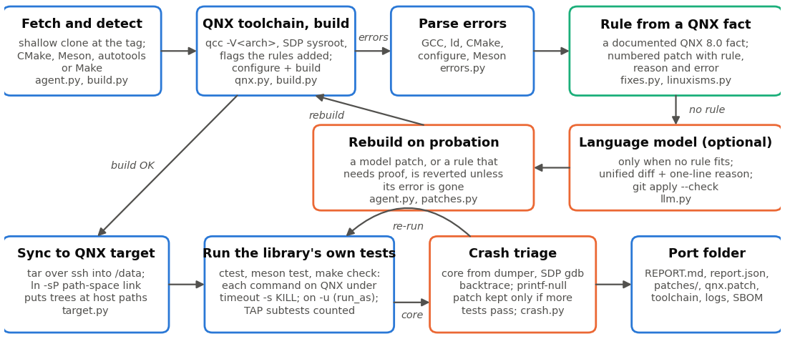

# Porting C/C++ Libraries to QNX 8.0 with On-Target Verification: Rules, a Verified Language-Model Step, and What 61 Libraries Taught Us

**The Good Engineers: Chirag, Bhumika, Ayush and Abhijeet**

qnx-porter, QNX Global Hackathon entry <https://github.com/thegoodengineers/qnx-porter>

> The PDF, `paper/qnx-porter.pdf`, is built from `paper/qnx-porter.tex`; this page is generated from the same source by `paper/build.py`, and every number in it comes from the repository's result files.

## Abstract

Most open-source C and C++ libraries have never been built for QNX 8.0, and a library that merely compiles for a real-time OS has not been shown to work there. We present qnx-porter, a tool that cross-compiles a library with the QNX SDP's `qcc`, fixes what breaks with deterministic rules grounded in documented QNX 8.0 facts, records every change as a numbered patch with its reason and the compiler error it answers, and counts a port only when the library's own test suite runs on a QNX 8.0 target. An optional language-model step proposes a diff for errors no rule covers; the diff is kept only if a rebuild clears the error and is reverted otherwise. Over 61 libraries at the latest upstream releases in campaign.yaml, 58 built for x86_64 and 58 for aarch64 on QEMU; 1563 of 1658 and 1546 of 1642 of their own tests passed on the target, with 0 patches from the model. On the 2 libraries the rules could not build that are not Linux-only by design, the model step built 2, keeping 2 patches and reverting 0; its libuv fix makes the same changes as upstream libuv's later QNX pull request. The same pipeline built 21 of 22 Rust crates and passed 2751 of 2764 of their tests on x86_64. Running tests on the target exposed QNX 8.0 C-library behaviour that glibc-tested code does not expect, including a `strtod()` that misrounds 51.05% of `%.17g` round trips. Every number in this paper is generated from a file in the repository.

## 1 Introduction

QNX is a real-time operating system used in vehicles, medical devices and industrial control. QNX 8.0 is free for non-commercial use, and QNX maintains a catalogue of ported open-source software [1] and hand-written build recipes [2]. Yet most open-source C and C++ libraries have never been built for QNX 8.0. Each missing library is work for an engineering team before it can even start, and the work repeats: the same missing header, the same socket functions that live in `libsocket` rather than libc, the same Linux-only call, library after library.

Compiling is the easy half. QNX binaries do not run on the build host, so a cross-build that succeeds proves little. A library can compile against the QNX headers and still crash on the target because QNX's C library makes different, equally legal, choices from glibc where the C standard leaves behaviour undefined or unspecified. For a real-time system the bar is higher still: its dependencies should be shown to work on the target, and every change made to them should be reviewable, because the industries QNX serves review every change to a dependency.

We built qnx-porter for the QNX Global Hackathon to make that work routine. Given a git URL and a tag, it detects the build system, writes a QNX toolchain for `qcc`, builds, parses the errors, fixes what it can, rebuilds, copies the build to a QNX 8.0 target and runs the library's own tests there. This paper reports what the tool does and what 61 libraries, two architectures and 22 Rust crates showed.

**Contributions.**

- A porting pipeline whose output is evidence: per library a report, a numbered patch per change with the rule, the reason and the exact compiler error, a single `qnx.patch`, the toolchain file, every build and test log, and an SPDX SBOM (Section 3).
- A corpus of 41 Linux-isms and the documented QNX 8.0 answer to each, turned into deterministic rules, each with a test (Section 3.3).
- A language-model step that is kept only when a rebuild proves it, and an evaluation showing that its fixes match the changes QNX-aware engineers made upstream (Section 4.3).
- On-target test execution that runs CMake, Meson and automake test suites unchanged on QNX, plus crash triage from QNX core dumps that repairs one common class of glibc-only test code automatically (Section 3.6).
- A two-architecture campaign on QEMU, a comparison with QNX's own hand-made ports, a Rust crate campaign, a real-time latency study, and a set of QNX 8.0 C-library findings, each reproduced with a stand-alone program (Sections 4 and 5).

## 2 Background

**QNX 8.0 and the SDP.** QNX OS 8.0 is a microkernel RTOS with a POSIX C library. Software for it is built on a Linux or Windows host with the QNX Software Development Platform (SDP). The SDP's compiler driver, `qcc` [3], wraps GCC; a `-V` argument selects the target, for example `-Vgcc_ntox86_64` or `-Vgcc_ntoaarch64le`, and the target headers and libraries live under `$QNX_TARGET`. Our SDP is build 141 with GCC 12.2.0. The SDP also ships GNU-style drivers (`x86_64-pc-nto-qnx8.0.0-gcc`) that autotools and Meson cross builds can use.

**Cross-compilation.** Nothing builds on a QNX device: a system in a car has no compiler. Every library is cross-compiled, so each needs a CMake toolchain file, a Meson cross file or a `--host` triplet, and the right flags. Most upstream projects ship none of these for QNX.

**QEMU targets.** QNX's `mkqnximage` [4] generates virtual-machine images, including QEMU images for x86_64 and aarch64le. We used it for both our targets: QNX 8.0 x86_64 under KVM, and QNX 8.0 aarch64le on the QEMU `virt` machine, fully emulated. No hardware was used; every aarch64 result in this paper is “aarch64 on QEMU”.

**Rust.** The Rust compiler has two QNX 8.0 targets, `x86_64-pc-qnx` and `aarch64-unknown-qnx`. Both are Tier 3: Rust ships no prebuilt standard library for them, so `std` is built from source with `-Zbuild-std`, and full standard-library support is marked as in progress [5].

**Why “it compiles” is not a port.** A cross-build exercises the headers and the linker, not the behaviour. Where C leaves behaviour undefined (passing `NULL` to `%s`) or unspecified (the leading digit of `%a`), glibc and QNX's libc legitimately differ, and test suites written against glibc encode glibc's choices. Only running the tests on the target reveals this; Section 5 shows such cases, some of them QNX defects.

## 3 Design

Figure 1 shows the pipeline for one library. Each box names the source file that implements it; the whole tool is 2964 lines of Python with no runtime dependencies, and 164 tests run in CI without QNX.



*Figure 1. The qnx-porter pipeline for one library. Blue: steps every port takes. Green: deterministic rules. Orange: steps whose output is kept only if a later check proves it (a rebuild, or more tests passing).*

### 3.1 Detection, toolchain and build

qnx-porter makes a shallow clone at the tag and tags it `qnx-porter-base`, so every later change is a git diff against upstream. It detects CMake, Meson, autotools or plain Make from the files present. It then reads `QNX_HOST` and `QNX_TARGET` from the SDP environment and writes what the build system needs: a CMake toolchain (`CMAKE_SYSTEM_NAME QNX`, `qcc` as the compiler with `CMAKE_C_COMPILER_TARGET gcc_ntox86_64` or `gcc_ntoaarch64le`, `CMAKE_SYSROOT`), a Meson cross file, or a GNU host triplet. Empty `libpthread.a`, `librt.a` and `libdl.a` stand in for libraries whose functions QNX keeps in libc, so `-lpthread` and CMake's library checks succeed without editing the project. Tests are turned on, and builds carry `-g` so that crash backtraces have file and line.

One lesson shaped this step: CMake reads `CMAKE_*_INIT` flags only into a fresh cache. Our first campaign silently ignored every flag fix after round one (mbedtls “received” `-lsocket` again and again). The loop now deletes the CMake cache whenever a fix changes the toolchain.

### 3.2 Error parsing

The parser turns GCC, GNU ld, CMake, configure and Meson output into diagnostics: implicit declaration, undeclared symbol, missing header, `-Werror` warning, undefined reference, missing `-l` library, multiple definition, and configuration errors. A diagnostic's identity across rebuilds ignores line numbers, because a patch that adds lines moves them.

### 3.3 Rules with documented QNX facts

Each rule acts only on what the compiler or linker printed plus a fact about QNX 8.0, and each fact has a source: the QNX C library reference (the header and the “Library:” line of a function), the io-sock networking guide, the QNX 8.0 migration guide, or a symbol listing of the SDP's own libraries. The corpus has 41 entries; some examples:

- sockets and `__inet_pton` are in `libsocket` (rule `link-libsocket`); POSIX regex is in `libregex`; `isinf` and friends need `libm`;
- `<sys/errno.h>` and other `<sys/...>` aliases do not exist (`header-alias`);
- `SA_RESTART` is listed as “not supported yet” in QNX 8.0's `<signal.h>` (`sa-restart` defines it as 0, so interrupted calls return `EINTR`);
- glibc's `htobe32` family is in `<net/netbyte.h>` (`endian-netbyte`);
- libc exports `wcwidth()` but not `wcswidth()` (`wcswidth-compat`);
- `qcc` rejects `--sysroot` (`qcc-sysroot`); a function hidden by a strict `-std=` needs `-D_QNX_SOURCE` (`qnx-source`).

Linux-only code that is actually used, such as an epoll loop or `sendfile()`, is never rewritten by a rule: a mechanical replacement would compile and change behaviour under load. It gets a QNX-specific hint and goes to the model step or to a person. Rules apply at most one fix per file and per flag in a round and never the same fix twice. A rule whose correctness is not obvious from the error, such as adding QNX to an OS `#if` chain, is applied alone and put on probation like a model patch.

### 3.4 Patches with reasons

Every change becomes a numbered file in `patches/` with a header naming the rule, whether a rule or the model wrote it, the one-sentence reason, and the exact error it answers. Source changes are git commits in the checkout; flag changes are diffs of the generated toolchain. All kept source changes are exported as one `qnx.patch` that applies to the upstream tag. Reading our own patches found two quality bugs that tests had not: a rule rewrote CRLF files with LF line endings (one patch replaced every line of a file to change a few), and a helper was inserted inside a non-Windows `#else` branch, which would break the patched file on MSVC. Both are fixed and tested.

### 3.5 The language-model step

Only when no rule fits, and only if an endpoint, a model name and a key are set in the environment, qnx-porter asks a language model. The prompt holds the error, the code around it, the end of the build log and the QNX hint for that kind of error; the answer must be a unified diff and a one-sentence reason. The diff must pass `git apply --check`. It is then always on probation: after the rebuild it is reverted if the error it targeted is still there or if new errors appear in the files it touched, and the report lists it as `reverted`. New errors elsewhere count as progress, because a compile fix lets the linker run; an early version reverted proven fixes for exactly that reason. The model is asked at most 2 times per error. Nothing about the endpoint is stored in the repository or in any report.

### 3.6 Running the library's own tests on QNX

**Sync and path-space links.** The source and build trees are copied to the target with `tar` over ssh. Generated test scripts hard-code absolute host paths, so qnx-porter uses QNX's path-space links (`ln -sP`) to make the copied trees appear on the target at the same absolute paths as on the host. The scripts then run unchanged. **Every test command on QNX.** CMake applies `CMAKE_CROSSCOMPILING_EMULATOR` only to executable targets, so ctest would run a test written as a shell script on Linux, where it tries to execute QNX binaries. json-c's first run reported 0 of its tests passing for this reason, which was our fault, not QNX's. qnx-porter therefore reads ctest's JSON test list and runs every command on QNX itself, applying ctest's `WILL_FAIL`, pass and fail regular expressions (CMake's `.` matches newlines; Python needs `DOTALL`) and skip rules. `cmake -E` helper steps are mapped to the QNX shell commands that do the same. Meson suites go through an `exe_wrapper`; automake suites through a generated `LOG_COMPILER`, after building the test programs that automake builds only inside `make check`. A test that needs an interpreter the target lacks is reported as not runnable, never as passed or failed. **Timeouts and users.** A test killed on the host side kept running on QNX, so each test now runs under QNX's own `timeout -s KILL` with a 300 s cap. Suites that refuse to run as root (libuv) run as another user through QNX's `on -u` (`run_as` in the campaign file). **TAP subtests.** Some test binaries report many subtests in TAP. qnx-porter counts `ok`, `not ok` and `SKIP`/`TODO` lines and names every failing subtest in the log, so a binary that “fails” is not mistaken for a suite that fails entirely. **Crash triage.** The `mkqnximage` image runs QNX's `dumper`, which writes a core for each crashing process. qnx-porter copies the cores to the host and reads them with the SDP's own gdb against the QNX target libraries. One crash class is repaired automatically: a backtrace through `strlen` from a printf-family call in the library's own code means a `NULL` `%s` argument, which glibc prints as `(null)` and QNX's libc faults on. The `printf-null` rule wraps that call's string arguments in a helper, rebuilds and re-runs the tests; the patch stays only if more tests pass.

### 3.7 Campaigns

A campaign script ports every library in a YAML file, checks `qcc` and the target first, records which libraries oss.qnx.com already lists, and writes `results/ports.csv` from each port's `report.json`; a second script rewrites the README table and headline from that CSV, and CI fails if the two disagree. A weekly job builds every library at its upstream default branch on a self-hosted runner with the SDP.

## 4 Evaluation

Every number in this section is read by `paper/build.py` from a file in the repository; the file is named where the number appears.

### 4.1 C/C++ campaign on x86_64 and aarch64 on QEMU

The campaign ported 61 libraries at the latest upstream releases in campaign.yaml: parsers (JSON, XML, YAML, CBOR, TOML), compression, cryptography and TLS, messaging (MQTT, nng, OPC UA, CoAP, Modbus), logging and formatting, test frameworks and codecs. 10 were chosen because neither oss.qnx.com nor the qnx-ports organisation had them when checked (`results/candidates_check.csv`: 10 of 10); the rest are widely used, and some are on oss.qnx.com already, which makes them a direct comparison. The headline runs used rules only. Table 1 summarises `results/ports.csv`; Figure 2 breaks the outcomes down and Figure 3 shows every library whose tests ran.

*Table 1. C/C++ campaign, from `results/ports.csv`. Both targets are QEMU: x86_64 under KVM, aarch64 on the emulated `virt` machine. “Tests” counts only libraries whose suite ran at least one test on the target.*

|  | x86_64 (KVM) | aarch64 (emulated) |
|---|---|---|
| Libraries | 61 | 61 |
| Built for QNX 8.0 | 58 | 58 |
| Libraries whose tests ran | 43 | 43 |
| Tests passed / total | 1563/1658 | 1546/1642 |
| Pass rate (%) | 94.3 | 94.2 |
| Kept patches (rule / model) | 31 / 0 | 32 / 0 |
| Built with no patch | 35 | 34 |
| Not on oss.qnx.com: built | 29 of 31 | 29 of 31 |
| Port time, hours | 5.8 | 10.1 |


*Figure 2. Outcome per library and architecture (`results/ports.csv`). “Registers no tests”: the default build defines none. “Not run”: the suite needs something the target lacks.*


*Figure 3. Share of each library's own tests that passed on the QNX 8.0 target, for every library whose suite ran at least one test (`results/ports.csv`). Labels give passed/total, x86_64 first where the architectures differ.*

In this run the same 58 libraries built on both architectures. The libraries that did not build were can-utils (Linux SocketCAN tools: expected not to port), libgpiod (Linux GPIO character-device API: expected not to port) and libwebsockets on both architectures. In the 2024-pin run, libuv and libwebsockets stopped on errors no rule covered (`struct qtime_entry` has no `nsec` member in QNX 8.0; `TCPCTL_KEEPCNT`); QNX's own ports of both libraries change exactly those lines (Section 4.2), and the model step builds both (Section 4.3).

Figure 4 counts kept patches by rule. The most frequent rule on x86_64 is `link-libsocket` (6 patches); 15 distinct rules fired on x86_64 and 16 on aarch64. The `printf-null` crash repair was kept in 4 libraries on x86_64 (capstone, json-c, libconfig and tinyxml2). Rules that fired only on aarch64 (signed-char) exist because of the architecture (Section 5.8).


*Figure 4. Kept patches by rule, per architecture, from `ports*/*/report.json`.*

What the failing tests are, from the logs and from reproduction outside the campaign: QNX C-library behaviour (Section 5); `printf("%s", NULL)` in places the `printf-null` rule cannot rewrite (inside libxml2's generic error code, and in nng 1.9 behind a tail call that hides the caller in the backtrace); nng 2.1's poller, which waits for a `POLLHUP` that QNX does not report (Section 5.6); output that differs from glibc's but is allowed by C (benchmark's tie rounding, fmt's `%a`); and things the test image lacks: `killall` (libmodbus), `/bin/echo` (pcre2grep), internet access (nng 1.9), the `en_US.UTF-8` locale (benchmark), enough memory for one zstd test, a `locale` command (pcre2). None of the failures was excluded by hand.

**How the numbers got here.** Table 2 lists every x86_64 campaign run as the campaign script summarised it in `results/runs/`. The first 5 runs used 10 libraries. Most of the change between runs was in our harness, not in the rules: the CMake cache problem above, autotools configured in the wrong folder, automake test programs never copied to QNX (libsodium went from none to all of its tests passing), `.sh` tests that ran on Linux, and the DOTALL regex fix. Run 6 counted libraries whose suite registered no tests as “tests ran”; from run 7 the summary counts only libraries with at least one test.

*Table 2. x86_64 campaign runs, from the last summary line of each `results/runs/campaign-N.log`. Run 5 re-ran only json-c and libconfig; its line summarises the whole CSV.*

| Run | Libraries | Built | Tests ran | Passed/total |
|---|---|---|---|---|
| 1 | 10 | 4 | 4 | 68/72 |
| 2 | 10 | 9 | 9 | 292/381 |
| 3 | 10 | 9 | 9 | 372/381 |
| 4 | 10 | 10 | 9 | 372/381 |
| 5 | 10 | 10 | 9 | 376/381 |
| 6 | 61 | 50 | 48 | 1185/1345 |
| 7 | 61 | 57 | 33 | 1332/1366 |
| 8 | 61 | 58 | 43 | 1563/1658 |

### 4.2 Against QNX's hand-made ports

QNX maintains hand-made recipes in `qnx-ports/build-files` [2]. 21 of our libraries have one; `docs/related/qnx-ports-comparison.md` compares them library by library against build-files commit `1964dba` and QNX's forks (Table 3). The two sides are not the same experiment: versions differ for 13 of the 21, QNX's READMEs mostly report tests on a Raspberry Pi 4, and few of their recipes state test results.

*Table 3. qnx-porter's automatic ports against QNX's hand-made recipes (`docs/related/qnx-ports-comparison.md`).*

| Outcome | Libraries |
|---|---|
| Same QNX change or cause, found independently (libevent, mosquitto, googletest, tinyxml2, jansson, pugixml) | 6 |
| Same problem at the same place; QNX fixed it, our rules-only run did not (libxml2, libwebsockets, libuv) | 3 |
| No QNX source change on either side, both build (zlib, libjpeg-turbo, expat, libyaml, libpng, lz4, zstd, pcre2, sqlite) | 9 |
| Different, or not comparable (c-ares, benchmark, cJSON) | 3 |

Where both sides changed the same thing, the changes have the same effect, sometimes by a different mechanism: QNX's libevent fork leaves `SA_RESTART` out on QNX while our rule defines it as 0. For googletest, both open the saved working directory with `O_DIRECTORY`; we found it from the core dump of the aborting tests, but applied it by hand, not in the campaign. QNX's jansson and pugixml recipes link a separate float-conversion library because of the `strtod()` behaviour that our run traced from those same two libraries' failing tests (Section 5.1). Every rule involved was committed before we read QNX's recipes, and each was written from an error our own campaign hit. The difference is coverage: QNX's ports fix 3 problems that our rules-only run only reported, and some of their changes concern runtime behaviour (c-ares reads QNX's own resolver configuration) that our run cannot see when the library registers no tests.

### 4.3 The language-model step

`scripts/model_eval.py` re-ports, with the model step on, every library the rules-only campaign could not build, except libgpiod and can-utils, which use Linux-only kernel interfaces that no fix turns into QNX programs. The measured run uses the 2024 pins on the x86_64 target; the results are in `results/model_eval.csv`.

Of the 2 libraries (libuv and libwebsockets), 2 now build. The model kept 2 patches and 0 were reverted, from 2 calls with 0 failures, 7408 input and 2304 output tokens and 23.8 s of model time in total. Building is not passing: libuv's suite ran as a non-root user and its 0/2 test binaries did not pass as wholes, but inside them its own TAP subtests were 384 ok, 46 not ok and 9 skipped; libwebsockets registers no tests in its default build.

**Does the fix match what QNX-aware engineers did?.** The model never saw the upstream changes; we compared them afterwards. For libuv, QNX 8.0 removed `qtime_entry.nsec` and renamed the syspage entry `new_cpuinfo` to `cpuinfo`. Upstream libuv's own QNX change, pull request #4801 “Improved QNX support” [6], merged after the v1.49.2 we ported, makes the same two changes the model made: `uv_uptime()` reads `clock_gettime(CLOCK_MONOTONIC)` and returns the error on failure (upstream keeps whole seconds; the model also adds the nanoseconds), and the syspage access uses `cpuinfo` (upstream guards it with `#if __QNX__ >= 800`). For libwebsockets, QNX 8.0's `<netinet/tcp.h>` already defines the `TCP_KEEP*` options and has no `TCPCTL_KEEPCNT`; the model keeps the old fallback only where the options are missing, and QNX's own libwebsockets port changes the same lines.

2 libraries is a small sample and no patch was reverted in this run, so the revert path is shown only by the test suite, with a stand-in model. A model's answer can differ between runs; each run's patches and reasons are kept in `ports-model/`.

### 4.4 Rust crates

A feasibility gate came first: with `rustc 1.102.0-nightly`, `-Zbuild-std` and `qcc` as the linker, a program making 12 standard-library checks (threads, channels, files, time, TCP and UDP loopback, `process::Command`, environment, unwinding) passed all of them on both targets (`docs/rust/GATE.md`). The crate porter then never edits a crate's own code. Many dependencies support QNX 7 (`target_os = "nto"`) but not QNX 8.0 (`"qnx"`); rule `nto-to-qnx` vendors a copy that lets QNX 8.0 take the QNX 7 path and applies it through cargo's `[patch]` table, and rule `libc-update` moves a too-old pinned `libc` within its semver range. Whether the QNX 7 path is right on QNX 8.0 is shown by the tests, not assumed.

Figure 5 shows `results/crates.csv` and `results/crates-aarch64le.csv`. On x86_64, 21 of 22 crates built and 2751 of 2764 tests passed (99.5%) in the 18 crates whose tests ran; on aarch64 on QEMU, 21 built and 2721 of 2733 passed. nix did not build: it needs QNX 8.0 errno support beyond the rule. The failing tests read Android time-zone files (chrono), compile code at test time (serde_json), or assume `/tmp` is not a link (tempfile); one crossbeam-channel test fails on x86_64 only and is not yet explained.


*Figure 5. Tests passed per Rust crate on QNX 8.0 (log scale), from `results/crates*.csv`. Right-hand labels give passed/total where any test failed.*

### 4.5 Real-time scan and latency

A library that passes its tests can still be wrong for a real-time thread. `scripts/rt_report.py` adds two views. A static scan of each library's own sources (61 libraries, `results/rt_scan.csv`) counts calls that can make a thread wait: heap allocation (found in 56 libraries), blocking I/O, sleeps, process creation, signals, threads the library starts itself (11) and locks (18). Its score, from 0 to 100, ranks libraries; it certifies nothing, because a scan cannot tell which calls are on the path an application uses.

The latency harness is C, built with `qcc` and run on the target. It times one core call per library 20000 times with `ClockCycles()` at `SCHED_FIFO` priority 60: idle, under load (load threads on all 4 CPUs), and under load with the measuring thread isolated on its own CPU by a QNX runmask (`ThreadCtl(_NTO_TCTL_RUNMASK)`). 14 of 16 libraries were measured (`results/rt.csv`); libsodium and msgpack-c were not, because their harness did not compile. Figure 6 shows p99. Isolation at least halved loaded p99 for 1 library: zlib, from 139.248 to 24.535 µs.


*Figure 6. p99 latency of one call per library on QNX 8.0 x86_64 in QEMU (`results/rt.csv`). QEMU timing, not hardware timing: use it to compare libraries, not as a bound.*

**The QEMU caveat is essential here.** A virtual CPU can be descheduled by the host at any moment, so absolute numbers, and maxima most of all, say little about hardware. For 7 libraries (cJSON, expat, json-c, miniz, pcre2, xxHash and yyjson) idle p99 was above loaded p99, which on a dedicated core would be unusual and here is a sign of host noise. The harness ran on x86_64 only.

### 4.6 Recipes for QNX's build-files

For CMake ports that qnx-ports does not have, `scripts/emit_recipes.py` writes recipes in the build-files layout with the campaign's flags and `qnx.patch`. Each was built with QNX's recursive make for `nto-x86_64-o` from a fresh clone: 34 of 34 built (`recipes/BUILD_CHECK.md`). An earlier pass, before fixes to the generator, failed 4 recipes on install paths, a missing submodule and a stub library. For `nto-aarch64-le`, only yyjson, wolfssl and flac were built. The recipes and a pull-request text for QNX are drafted and have not been sent.

### 4.7 Licences and SBOM

Every port has an SPDX 2.3 [7] SBOM for the upstream package at the ported commit, with `qnx.patch` and its hash as a patch for that package. The declared licence is ScanCode Toolkit's summary [8] (scancode-toolkit-32.5.0) over the top-level and first-level licence, copying, notice and README files (`results/licences.csv`). Of 61 libraries, 9 have a GPL or AGPL licence in their expression, 7 an LGPL licence, 9 a weak copyleft licence (LGPL, MPL, EPL or CPL) and 1 none detected. This matters on QNX, where products ship as one image that often links libraries statically. The table is scanner output for triage, not a legal review.

### 4.8 Campaign robustness

Long campaigns on a laptop fail for reasons that have nothing to do with QNX. During the final x86_64 run (1 h 54 min), a DNS outage in WSL stopped 6 libraries at `git clone`; they were re-run into the same log. In the aarch64 campaign, a DNS outage made 60 clones fail within seconds, and an earlier attempt hung for 1800 s on an ssh copy to a target that had stopped answering. Under host overload, ssh to the emulated target timed out during the banner exchange and tests were lost; libjpeg-turbo, nng and flac were re-run on a quiet host. A sleeping laptop paused WSL and QEMU, losing 12 hours. The campaign now retries clones when the network is down, restarts a target that stops answering (`--restart-target`), and continues with `--resume` from the first library without a report. An emulated target needs the machine to itself.

## 5 Findings about QNX 8.0

Each finding below came from a library's own test failing on the target and was then reproduced outside the campaign with a few-line program, run on the QNX 8.0 x86_64 target and on Linux with glibc (`docs/qnx-reports/`). The reports are drafts and have not been sent to QNX.

### 5.1 `strtod()` is not correctly rounded

`strtod_roundtrip.c` prints 100000 random finite doubles with `%.17g` and parses each back. On QNX 8.0, 51051 (51.05%) came back different, by up to 4 units in the last place; with glibc, none did. `sscanf("%lf")` on QNX returns the correctly rounded value. The digits `%.17g` prints are within the bound for which C17 [9] requires correct rounding of an IEEE double, so text formats lose values on a round trip. This one cause explains 7 of pugixml's 962 checks, jansson's real-number tests and one yaml-cpp test; QNX's own jansson and pugixml recipes work around it by linking a separate float-conversion library. Separately, `printf("%.20f")` truncates the last printed decimal where glibc rounds it.

### 5.2 `strftime()` writes nothing for `%Ex`, `%EX`, `%Ec`

In the C locale, QNX 8.0's `strftime()` and `wcsftime()` return 0 for these three conversions. POSIX requires a modified conversion to behave as the unmodified one when the locale has no alternative format [10], and QNX's own 8.0 documentation says the same [11]. fmt's chrono tests fail on exactly these (6 + 6 assertions) at fmt 11.0.2, the 2024 pin; fmt 12.2.1's chrono tests pass on x86_64. A third fmt failure, `%a` printing a different leading hexadecimal digit, is not a bug: C leaves that digit unspecified, and the test assumes glibc's.

### 5.3 `fchdir()` needs `O_DIRECTORY`

`open(".", O_RDONLY)` succeeds on QNX 8.0, but `fchdir()` on that descriptor fails with `ENOTDIR`; with `O_DIRECTORY` it works. This is documented [12], so it is a difference, not a bug, but googletest's QNX-only death-test path saves the working directory exactly that way, and its death-test programs abort. With one added flag, 61 death tests pass on QNX 8.0; QNX's googletest fork makes the same change.

### 5.4 `qsort()` with an inconsistent comparator

libsrtp's test helper shuffles a buffer by calling `qsort()` with a comparator that answers at random, which C makes undefined. In a guard-word test of 2000 calls, QNX's `qsort()` wrote outside the array 480 times and glibc's 0. That explains libsrtp's crashing tests; the fix belongs in libsrtp's test helper (a Fisher–Yates shuffle), not in QNX.

### 5.5 `printf("%s", NULL)`

A short program prints `[(null)]` with glibc and dies with a memory fault on QNX 8.0. C makes this undefined, so neither libc is wrong; the tests that do it are glibc-only. json-c's own expected output even contains `(null)`. This is the crash class the `printf-null` rule repairs. Several projects have since fixed it upstream independently (`docs/upstream/README.md`).

### 5.6 `poll()` reports no `POLLHUP` when a pipe's writer closes

On QNX 8.0, once the last write end of a pipe is closed, `poll()` on the read end reports `POLLIN` and never `POLLHUP`, also after `read()` returns end of file; Linux reports `POLLHUP`, and POSIX describes it for exactly this case. nng 2.1.0's poll thread stops only on that `POLLHUP`, so `nng_fini()` never returns and 61 of its 64 tests reached the time limit. We found it from `pidin` thread states and a core dump read with the SDP's gdb, then reduced it to a short program (`docs/qnx-reports/pipe-pollhup.md`). A two-hunk nng fix, drafted and not sent, takes the suite to 60 of 64 on QNX and keeps all 74 tests passing on Linux.

### 5.7 The main thread's stack

A QNX process's main thread gets about 464 KiB of stack unless the program is linked with `qcc -N`; `ulimit -s` reports unlimited and does not change it (`scripts/stack_probe.c`; 7472 KiB with `-N8M`). Linux usually gives 8 MiB. cJSON 1.7.19's `misc_tests` overflowed it at recursion depth 6540. Crash triage now recognises a backtrace that is one function calling itself and relinks with `-N8M` (rule `main-stack`), kept because the re-run passed 19 of 19.

### 5.8 aarch64-specific differences

These differences appeared only on aarch64 on QEMU, and each is now a rule or a triage change with a test:

- **Word size.** `cmocka.h` infers a 64-bit platform only from glibc's `__WORDSIZE` or `__x86_64__`; on aarch64 QNX it assumed 32 bits and redefined `uintptr_t` as `unsigned int`. Rule `wordsize-64` fixes it.
- **Unsigned `char`.** Plain `char` is unsigned on aarch64, so a yaml-cpp test's negative constant in a `char` array is a narrowing error. Rule `signed-char` adds `-fsigned-char`.
- **`__generic_strlen`.** QNX's aarch64 libc names its `strlen` frame `__generic_strlen`, so the `printf-null` triage did not recognise the crash until it learned the name; json-c then passed all its tests on aarch64 too.
- **Backtrace depth.** QNX's aarch64 `malloc` takes five frames of a crash backtrace, so a 12-frame backtrace of cJSON's stack overflow held only six recursive frames and the `main-stack` rule, which needs eight, did not fire. The triage now reads 24 frames, and cJSON passed 19 of 19 on aarch64 as well.

mbedtls's PBKDF2 suite exceeds the 300 s per-test limit on the emulated CPU (it passes on x86_64). Other differences between the architectures are not explained yet: libsrtp, flac and the number of tests libjpeg-turbo registers differ (Figure 3).

## 6 Threats to validity

**QEMU only.** Both targets are QEMU; no hardware was used. x86_64 runs under KVM; aarch64 is fully emulated and much slower, which interacted with the 300 s test cap (flac tests hit it). The latency figures in particular are QEMU timing.

**One run per architecture.** A flaky test can pass or fail by chance: nng's `sockaddr_test` failed in one run and passed when re-run by hand. The aarch64 campaign also lost tests to host overload before re-runs.

**Test coverage.** Of the 58 libraries that built on x86_64, only 43 ran at least one of their own tests; 11 register no tests in their default build and 4 are build-only on purpose because their suites need Tcl, an MQTT broker, the build host, scons, or a runner we do not drive. For those, “built” means compiles and links for QNX 8.0, nothing more. Pass counts are the libraries' own, so a library with one test binary counts the same as one with hundreds of cases.

**Versions.** The published C/C++ results use the latest upstream releases in campaign.yaml; `campaign.yaml` names newer releases for 56 libraries. A change one version needs may not exist in another, which also limits the comparison with QNX's recipes. This paper regenerates from whatever the CSVs say, so a later campaign updates every number here, but prose about specific failures describes the run whose logs it cites.

**Model nondeterminism.** The model step was evaluated on 2 libraries, once, on x86_64 only. Another run may produce a different patch; the probation rule bounds what a wrong one can do, not whether a right one appears.

**ScanCode limits.** Licences come from top-level and first-level files only, so a licence stated only in source headers is not seen; ScanCode joins licences in one file with AND even when the file offers a choice.

**Our own harness.** Several early results were our bugs, not QNX's (Table 2). We found them by distrusting surprising numbers; there may be others.

## 7 Related work

**QNX ports.** QNX's `qnx-ports/build-files` [2] holds hand-made recipes in which an engineer adapts each library, and oss.qnx.com [1] lists ported packages. qnx-porter is complementary: it generates the port, tests it on a target, and emits recipes in their layout for libraries they lack.

**Cross-compilation tooling.** Embedded Linux build systems such as the Yocto Project [13] and Buildroot [14] build complete systems from per-package recipes, and package managers such as Conan separate build and host contexts for cross-building [15]. All of them assume someone has already written a recipe that works for the target; qnx-porter targets the step before that, for an OS whose C library differs from glibc, and it adds on-target tests as the acceptance criterion.

**Build failures and their repair.** Build errors are frequent and costly; at Google, dependency errors were the most common category [16]. HireBuild repairs Gradle build scripts from historical fix patterns [17]; BuildMedic repairs Maven dependency breakage [18]; Lou et al. showed that a simpler approach using current project information and external resources fixes more build failures than the history-driven one [19]; DeepDelta learns repairs for Java compilation errors from developer history [20]. qnx-porter's rules are closer to hand-written fix patterns, but each is tied to a documented platform fact rather than mined from history.

**Program repair and language models.** Test-suite-guided repair goes back at least to GenProg [21]; Monperrus surveys the field [22]. Xia et al. showed that large pre-trained language models are competitive program repairers [23]; SWE-bench evaluates models on real repository issues [24]; CompileAgent uses a tool-integrated agent to compile real repositories [25]. Our model step is deliberately narrow: one error, one diff, kept only if a rebuild clears that error, with the library's own tests on the target as the final judge.

## 8 Conclusion and future work

Porting a C or C++ library to QNX 8.0 is mostly repetitive, and the repetitive part can be automated with rules that cite documented platform facts and leave a reviewable patch for every change. The part that matters for a real-time system, whether the library works on the target, needs the library's own tests to run there; doing that found differences in QNX 8.0's C library that a cross-build alone would never show. A language model helps with the long tail when its output is treated as a hypothesis that a rebuild must confirm.

Future work: hardware targets, starting with a Raspberry Pi; repeated runs to separate flaky tests from real failures; the latest-release campaign; the latency harness on aarch64; more of the tests that libraries keep behind build options; sending the drafted upstream patches and QNX reports, which needs a person to review and sign them; and the model step on a larger set of libraries.

## A Artifact

Everything is in <https://github.com/thegoodengineers/qnx-porter>. Host: Ubuntu 22.04 or 24.04, or WSL2. QNX SDP 8.0 needs a free QNX licence (`SETUP.md`).

**Without QNX.**

```
python3 -m pip install --user --upgrade pip
python3 -m pip install --user -e ".[test]"
python3 -m pytest -q
```

**The QEMU targets.**

```
sudo scripts/qemu_target.sh net
scripts/qemu_target.sh build
scripts/qemu_target.sh start
export QNX_TARGET_ARCH=aarch64le
scripts/qemu_target.sh build
scripts/qemu_target.sh start
```

**One library, then the campaigns.**

```
source ~/qnx800/qnxsdp-env.sh
qnx-porter doctor
qnx-porter port \
  https://github.com/json-c/json-c.git \
  --tag json-c-0.18-20240915 \
  --target root@172.31.1.11
python3 scripts/run_campaign.py --no-model \
  --campaign campaign-2024.yaml
python3 scripts/run_campaign.py --no-model \
  --campaign campaign-2024.yaml \
  --arch aarch64le --target root@172.31.1.12
python3 scripts/model_eval.py \
  --campaign campaign-2024.yaml
python3 scripts/run_crates.py
python3 scripts/run_crates.py --arch aarch64le \
  --target root@172.31.1.12
python3 scripts/rt_report.py \
  --target root@172.31.1.11
```

The model step reads `QNX_PORTER_API_KEY`, `QNX_PORTER_MODEL` and `QNX_PORTER_BASE_URL` from the shell only.

**This paper.**

```
python3 paper/figures.py
python3 paper/build.py
tectonic paper/qnx-porter.tex
```

`build.py` fails if the paper uses a number it does not define, so the PDF and `paper.md` always match the CSVs they were built from.

[1] QNX, “QNX open-source dashboard,” <https://oss.qnx.com/>, accessed Nov. 2026.

[2] QNX, “qnx-ports/build-files: QNX build files and instructions for ports,” GitHub, <https://github.com/qnx-ports/build-files>, accessed Nov. 2026.

[3] QNX, “qcc, q++,” QNX OS 8.0 Utilities Reference, <https://www.qnx.com/developers/docs/8.0/com.qnx.doc.neutrino.utilities/topic/q/qcc.html>.

[4] QNX, “mkqnximage,” QNX OS 8.0 Utilities Reference, <https://www.qnx.com/developers/docs/8.0/com.qnx.doc.neutrino.utilities/topic/m/mkqnximage.html>.

[5] The Rust Project, “*-nto-qnx-*,” The rustc book, platform support, <https://doc.rust-lang.org/nightly/rustc/platform-support/nto-qnx.html>.

[6] libuv, “Improved QNX support,” pull request #4801, merged 30 June 2025, <https://github.com/libuv/libuv/pull/4801>.

[7] The Linux Foundation, “The Software Package Data Exchange (SPDX) Specification, version 2.3,” <https://spdx.github.io/spdx-spec/v2.3/>.

[8] nexB and contributors, “ScanCode Toolkit documentation,” <https://scancode-toolkit.readthedocs.io/>.

[9] ISO/IEC, “ISO/IEC 9899:2018, Information technology — Programming languages — C,” 2018, <https://www.iso.org/standard/74528.html>.

[10] The Open Group and IEEE, “strftime, strftime_l,” The Open Group Base Specifications Issue 8, IEEE Std 1003.1-2024, <https://pubs.opengroup.org/onlinepubs/9799919799/functions/strftime.html>.

[11] QNX, “strftime(),” QNX OS 8.0 C Library Reference, <https://www.qnx.com/developers/docs/8.0/com.qnx.doc.neutrino.lib_ref/topic/s/strftime.html>.

[12] QNX, “fchdir(),” QNX OS 8.0 C Library Reference, <https://www.qnx.com/developers/docs/8.0/com.qnx.doc.neutrino.lib_ref/topic/f/fchdir.html>.

[13] The Yocto Project, <https://www.yoctoproject.org/>.

[14] Buildroot, “Making embedded Linux easy,” <https://buildroot.org/>.

[15] Conan, “How to cross-compile your applications using Conan: host and build contexts,” Conan 2 documentation, <https://docs.conan.io/2/tutorial/consuming_packages/cross_building_with_conan.html>.

[16] H. Seo, C. Sadowski, S. Elbaum, E. Aftandilian and R. Bowdidge, “Programmers' build errors: a case study (at Google),” in *Proc. ICSE*, 2014, pp. 724–734, doi: 10.1145/2568225.2568255.

[17] F. Hassan and X. Wang, “HireBuild: an automatic approach to history-driven repair of build scripts,” in *Proc. ICSE*, 2018, pp. 1078–1089, doi: 10.1145/3180155.3180181.

[18] C. Macho, S. McIntosh and M. Pinzger, “Automatically repairing dependency-related build breakage,” in *Proc. SANER*, 2018, pp. 106–117, doi: 10.1109/SANER.2018.8330201.

[19] Y. Lou, J. Chen, L. Zhang, D. Hao and L. Zhang, “History-driven build failure fixing: how far are we?,” in *Proc. ISSTA*, 2019, pp. 43–54, doi: 10.1145/3293882.3330578.

[20] A. Mesbah, A. Rice, E. Johnston, N. Glorioso and E. Aftandilian, “DeepDelta: learning to repair compilation errors,” in *Proc. ESEC/FSE*, 2019, pp. 925–936, doi: 10.1145/3338906.3340455.

[21] C. Le Goues, T. Nguyen, S. Forrest and W. Weimer, “GenProg: a generic method for automatic software repair,” *IEEE Trans. Softw. Eng.*, vol. 38, no. 1, pp. 54–72, 2012, doi: 10.1109/TSE.2011.104.

[22] M. Monperrus, “Automatic software repair: a bibliography,” *ACM Comput. Surv.*, vol. 51, no. 1, art. 17, 2018, doi: 10.1145/3105906.

[23] C. S. Xia, Y. Wei and L. Zhang, “Automated program repair in the era of large pre-trained language models,” in *Proc. ICSE*, 2023, pp. 1482–1494, doi: 10.1109/ICSE48619.2023.00129.

[24] C. E. Jimenez, J. Yang, A. Wettig, S. Yao, K. Pei, O. Press and K. Narasimhan, “SWE-bench: can language models resolve real-world GitHub issues?,” in *Proc. ICLR*, 2024, <https://arxiv.org/abs/2310.06770>.

[25] L. Hu, G. Chen, X. Shang, S. Cheng, B. Wu, G. Li, X. Zhu, W. Zhang and N. Yu, “CompileAgent: automated real-world repo-level compilation with tool-integrated LLM-based agent system,” in *Proc. ACL*, 2025, pp. 2078–2091, doi: 10.18653/v1/2025.acl-long.103.
